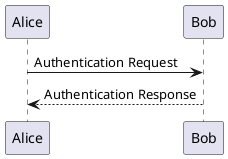
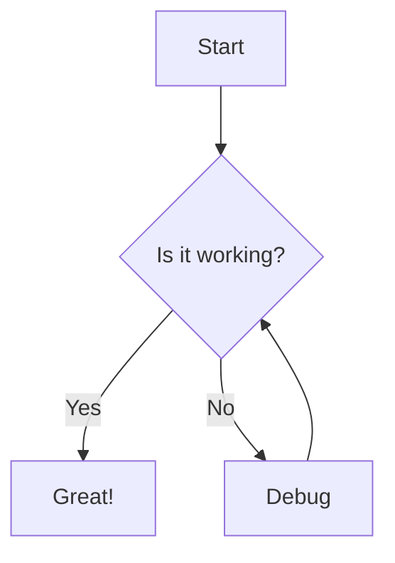

<!-- pagebreak -->

# الفصل الأول: المقدمة

هذا نص تجريبي يوضح قدرة الأداة على تحويل **النص الغامق** و*النص المائل* و~~النص المشطوب~~ بشكل صحيح.

يمكن أيضاً كتابة `كود برمجي داخل النص` بسهولة.

## متطلبات التطوير

لتطوير التطبيق تحتاج إلى:

1. لغة برمجة مناسبة مثل Python أو JavaScript
2. إطار عمل قوي
3. قاعدة بيانات موثوقة
4. أدوات اختبار

### الأدوات المساعدة

- محرر نصوص (VS Code)
- نظام تحكم بالنسخ (Git)
- منصة استضافة (Cloud)

<!-- pagebreak -->

# الفصل الثاني: البنية التقنية

| المكون | التقنية | الوصف |
|--------|---------|-------|
| الواجهة | React | مكتبة واجهات تفاعلية |
| الخادم | FastAPI | إطار عمل Python عالي الأداء |
| قاعدة البيانات | PostgreSQL | قاعدة بيانات علائقية |

> **ملاحظة:** من المهم اختيار التقنيات المناسبة حسب حجم المشروع ومتطلباته.


```python
def hello():
    print("Hello, World!")
```



