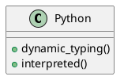

# مقدمة في Python

Python هي لغة برمجة **قوية** و *سهلة* التعلم. This is an English sentence within Arabic text.

## المتغيرات Variables

يمكنك تعريف متغير كالتالي:

```python
name = "Ahmed"
age = 25
print(f"Hello {name}")
```

### أنواع البيانات

1. **نصوص** (Strings): `"Hello"`
2. **أرقام** (Numbers): `42`, `3.14`
3. **قوائم** (Lists): `[1, 2, 3]`

> **نصيحة:** Always use meaningful variable names.

| الميزة | Feature | الوصف Description |
|--------|---------|-------------------|
| ديناميكي | Dynamic | لا حاجة لتحديد النوع |
| مفسر | Interpreted | يتم تنفيذ السطر تلو الآخر |
| كائني | OOP | يدعم البرمجة الكائنية |


